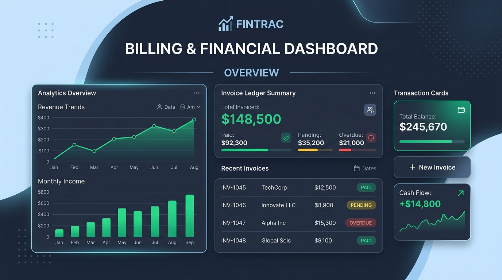
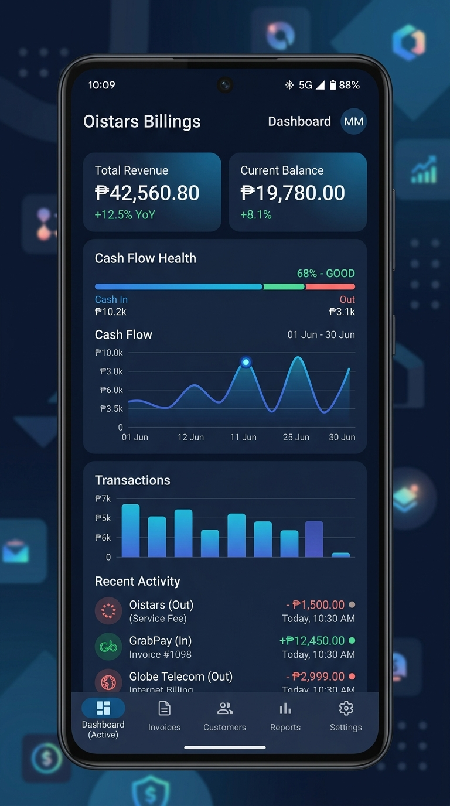
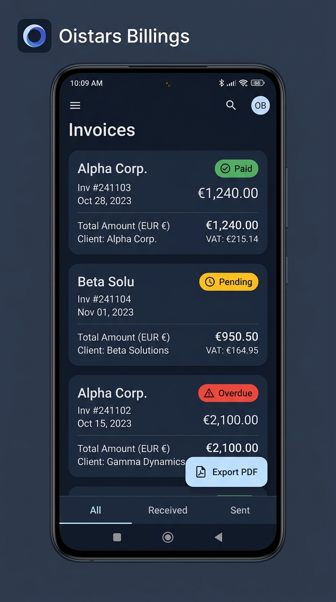
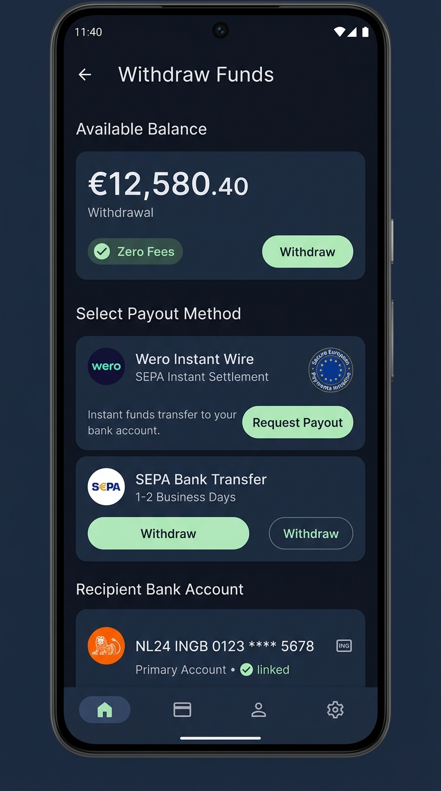
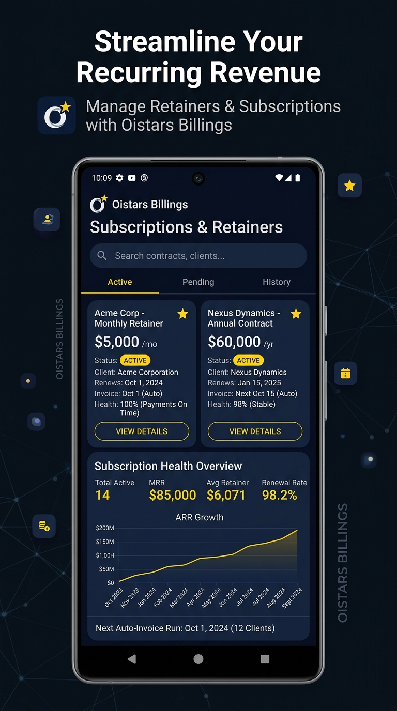

# Oistars Billings

[](https://www.bestpractices.dev/en/projects/1/passing)
[](https://securityscorecards.dev/)
[](LICENSE)
[](https://github.com/jpaul8282/Oistars-Billings2)
[](SECURITY.md)
[](USER_MANUAL.md)
[](CONTRIBUTING.md)
[](CHANGELOG.md)
[](PROGUARD_SECURITY.md)
[](#-bankwire--wero-instant-payout-system)
[](#-wero-european-payments-initiative-integration)

> **Enterprise-Grade Billing, Invoicing, Client Store Ledger & Instant Settlement Platform**  
> Built with Kotlin, Jetpack Compose, Material Design 3, Room, and Firebase Firestore  
> **Billing Owner & Merchant Lead**: Jurgen Paul Westerveld (`westerveldjp@gmail.com`)



---

## 📸 Google Play Store Showcase Screenshots

| 1. Financial Dashboard | 2. Invoice Lifecycle | 3. Instant Payouts & Wero | 4. Client Store Ledger | 5. Recurring Retainers |
|:---:|:---:|:---:|:---:|:---:|
|  |  |  |  |  |
| *Real-Time Revenue Analytics* | *Itemized Billing & PDF Export* | *Wero & SEPA Instant Clearing* | *Firestore Cloud Sync* | *Subscription Management* |

*For complete step-by-step instructions and store reviewer documentation, refer to the [Official User Manual](USER_MANUAL.md).*

---

## 📱 Overview

**Oistars Billings** is a complete, production-grade financial management platform tailored for modern businesses, e-commerce retailers, freelancers, agencies, and SMEs. It unifies high-density invoicing, client store ledgers, recurring subscription billing, and real-time European bank wire settlements.

---

## ✨ Core Capabilities

### 💼 1. Invoice & Financial Management
- **Complete Invoice Lifecycle**: Draft → Pending → In Transit → Paid → Archived.
- **Mathematical Integrity**: Subtotals, itemized VAT rates, trade discounts, and balance dues validated by automated unit tests.
- **Multi-Currency Support**: Native handling of EUR (€), USD ($), and GBP (£).
- **PDF Generation & Export**: Generate clean, professional PDF invoices with QR codes and payment details directly from device storage.

### 👥 2. Client & Store Ledger Management
- **Live Cloud Firestore Registry**: Synchronized with Google Firebase Firestore (`europe-west2`), tracking client status: *Good Standing, Active, Pending Balance, Overdue, Inactive*.
- **Client Profiles**: Full address records, tax IDs (KVK, VAT), custom payment terms, and direct email contacts.
- **Client Detail Modals**: One-tap invoice authoring pre-filled with client metadata.

### 🏦 3. Bankwire & Wero Instant Payout System
- **Real-Time Owner Draws**: Direct bank transfer settlements to ING Bank account **`NL43INGB0006372146`**.
- **Wero (European Payments Initiative)**: Instant account-to-account European wire settlement in under 5 seconds.
- **SEPA Instant Credit Transfer**: 24/7/365 zero-fee bank settlements across European SEPA zone.
- **Automated Scheduling**: Configurable automated payouts (Weekly, Bi-weekly, Monthly) with minimum threshold guards and reserve balances.

### 📊 4. Recurring Billing & Retainers
- **Subscription Engines**: Monthly, quarterly, and annual billing intervals.
- **One-Tap Billing**: Generate instant invoices from recurring contract profiles with automatic balance reconciliation.

### 🔐 5. Security & OpenSSF Compliance
- **Local-First Reliability**: Encrypted Room SQLite database guarantees offline operation.
- **Zero-Trust Firebase Firestore**: Granular user isolation rules gated behind Jetpack Credential Manager Google Sign-In.
- **R8 Full-Mode ProGuard**: Code shrinking, dead code elimination, and symbol obfuscation for production release builds.

---

## 🏦 Bankwire & Wero Instant Payout System

Oistars Billings features a dedicated **Owner Payouts & Settlement Suite** accessible from both the primary Dashboard and the persistent Navigation Bar.

### 💳 Beneficiary Account Information
| Parameter | Registered Value |
|---|---|
| **Account Holder** | Jurgen Paul Westerveld |
| **Organization** | Oistars International B.V. |
| **Beneficiary Bank** | ING Bank N.V. (Amsterdam, Netherlands) |
| **IBAN** | **`NL43INGB0006372146`** (Format: `NL43 INGB 0006 3721 46`) |
| **BIC / SWIFT** | **`INGBNL2A`** |
| **EPI / Wero Identifier** | `westerveldjp@gmail.com` |
| **Transfer Fee** | **€0.00 (Zero Fee / Free)** |

### ⚡ Wero (European Payments Initiative) Integration
Oistars Billings implements next-generation European account-to-account bankwire capabilities powered by **Wero (EPI)**:
- **Instant Settlement**: Clears within **< 5 seconds** directly into ING Bank account `NL43INGB0006372146`.
- **EPI Protocol Standard**: Native interoperability across European financial institutions (ING, BNP Paribas, Deutsche Bank, BPCE, etc.).
- **Receipt Auditing**: Every payout generates an immutable transaction receipt featuring cryptographic ID, clearing timestamp, and reference note.

```kotlin
// Example Payout Request via BillingViewModel
viewModel.requestOwnerPayout(
    amount = 1250.00,
    destinationBank = "ING Bank N.V.",
    destinationIban = "NL43 INGB 0006 3721 46",
    destinationBic = "INGBNL2A",
    speed = PayoutSpeed.WERO_INSTANT,
    reference = "Wero Instant Wire - Oistars Draw"
)
```

---

## 🔒 OpenSSF Security Practices & Verification

Oistars Billings adheres to the **Open Source Security Foundation (OpenSSF) Best Practices** to ensure supply chain integrity and application security.

### OpenSSF Compliance Matrix

| OpenSSF Criterion | Implementation in Oistars Billings | Status |
|---|---|:---:|
| **Basic Project Information** | Open documentation, clearly defined owner (Jurgen Paul Westerveld), professional README | ✅ Pass |
| **Vulnerability Reporting** | Dedicated [`SECURITY.md`](SECURITY.md) with responsible disclosure guidelines and 48h SLA | ✅ Pass |
| **Static Code Analysis** | Android R8/ProGuard enforcement, lint static analysis, type-safe Kotlin models | ✅ Pass |
| **Secrets Management** | Zero hardcoded keys; secrets managed via `.env` and Gradle Secrets Plugin | ✅ Pass |
| **Least Privilege Access** | Zero broad storage permissions (`READ_EXTERNAL_STORAGE` omitted); sandboxed files | ✅ Pass |
| **Automated Testing** | Comprehensive JUnit 4, Robolectric, and Roborazzi UI tests validating calculation logic | ✅ Pass |
| **Cryptographic Signatures** | Dedicated production signing config via `KEYSTORE_PATH` with separate debug keystore | ✅ Pass |
| **Dependency Pinning** | Version Catalog (`gradle/libs.versions.toml`) centrally controls all library versions | ✅ Pass |

---

## 🛡️ ProGuard & R8 Optimization

Release builds enable complete code obfuscation and shrinking:

```kotlin
// app/build.gradle.kts
buildTypes {
    release {
        isMinifyEnabled = true
        isShrinkResources = true
        proguardFiles(
            getDefaultProguardFile("proguard-android-optimize.txt"),
            "proguard-rules.pro"
        )
    }
}
```

Detailed documentation and rule explanations are provided in [`PROGUARD_GUIDE.md`](PROGUARD_GUIDE.md).

---

## 🏗️ Technical Architecture

```
┌────────────────────────────────────────────────────────┐
│               Jetpack Compose UI (M3)                  │
│  DashboardScreen  •  InvoicesScreen  •  OwnerPayoutScreen │
│  FirestoreClientsScreen  •  SubscriptionsScreen         │
└───────────────────────────┬────────────────────────────┘
                            │
                            ▼
┌────────────────────────────────────────────────────────┐
│             BillingViewModel (StateFlow)               │
└──────────────┬───────────────────────────┬─────────────┘
               │                           │
               ▼                           ▼
┌──────────────────────────────┐ ┌───────────────────────┐
│       Room Local DB          │ │ Firebase Cloud Sync   │
│  SQLite • Encrypted Sandbox  │ │ Firestore (London UK) │
│  Invoices • Clients • Payouts│ │ users/{userId}/...    │
└──────────────────────────────┘ └───────────────────────┘
```

---

## 🛠️ Build & Testing Instructions

### Prerequisites
- JDK 11+
- Android SDK 36 (compileSdk) / MinSdk 24
- Gradle 8.5+

### Build Debug APK
```bash
gradle assembleDebug
```

### Run All Unit & Robolectric Tests
```bash
gradle :app:testDebugUnitTest
```

### Production Release Build
```bash
export KEYSTORE_PATH=/path/to/keystore.jks
export STORE_PASSWORD=store_password
export KEY_ALIAS=upload
export KEY_PASSWORD=key_password
gradle assembleRelease
```

---

## 🛡️ OpenSSF Best Practices & Governance

This project adheres to the **OpenSSF Best Practices Badge (Passing Level)** standard:
- **[OpenSSF Best Practices Audit](OPENSSF_BEST_PRACTICES.md)**: Criterion-by-criterion verification report (66/66 passing).
- **[Security Policy](SECURITY.md)**: Coordinated Vulnerability Disclosure (CVD), SLA response commitments, and cryptographic standards.
- **[Contributing Guide](CONTRIBUTING.md)**: Contribution standards, PR workflows, and build verification.
- **[Code of Conduct](CODE_OF_CONDUCT.md)**: Contributor Covenant v2.1.
- **[Changelog](CHANGELOG.md)**: Semantic version history adhering to Keep a Changelog.
- **[Support Policy](SUPPORT.md)**: Official support channels and maintainer contact.

---

## 📄 License & Attribution

This project is licensed under the **[Apache License 2.0](LICENSE)**.

```
Copyright 2026 Jurgen Paul Westerveld <westerveldjp@gmail.com>

Licensed under the Apache License, Version 2.0 (the "License");
you may not use this file except in compliance with the License.
You may obtain a copy of the License at

    http://www.apache.org/licenses/LICENSE-2.0
```

**Lead Merchant & Developer**: Jurgen Paul Westerveld (`westerveldjp@gmail.com`)  
**Security Contact**: `security@oistars.nl`  
**General Support**: `oistarsentertainment@gmail.com`

